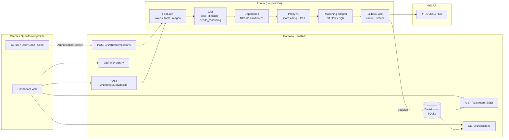
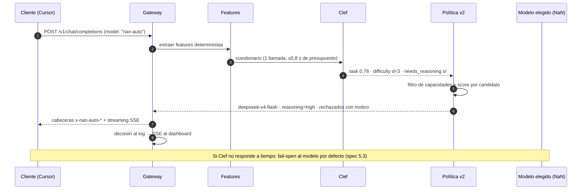
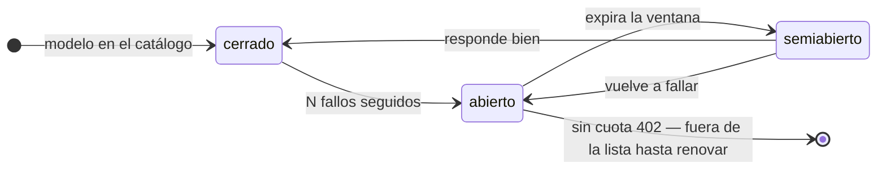
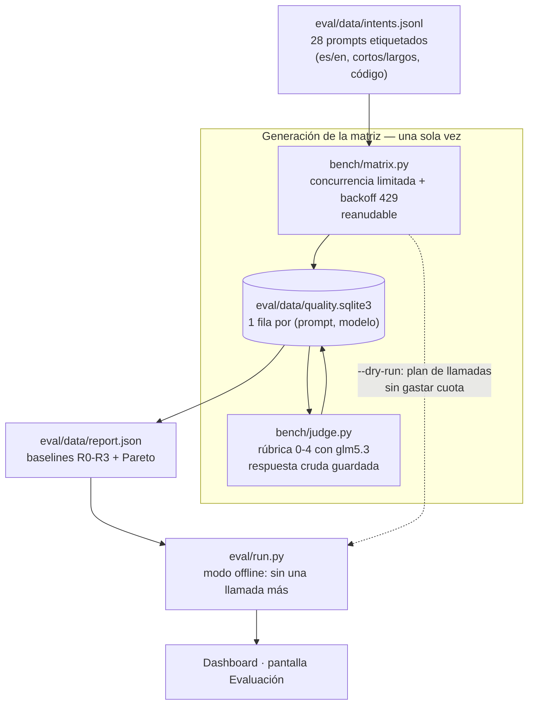
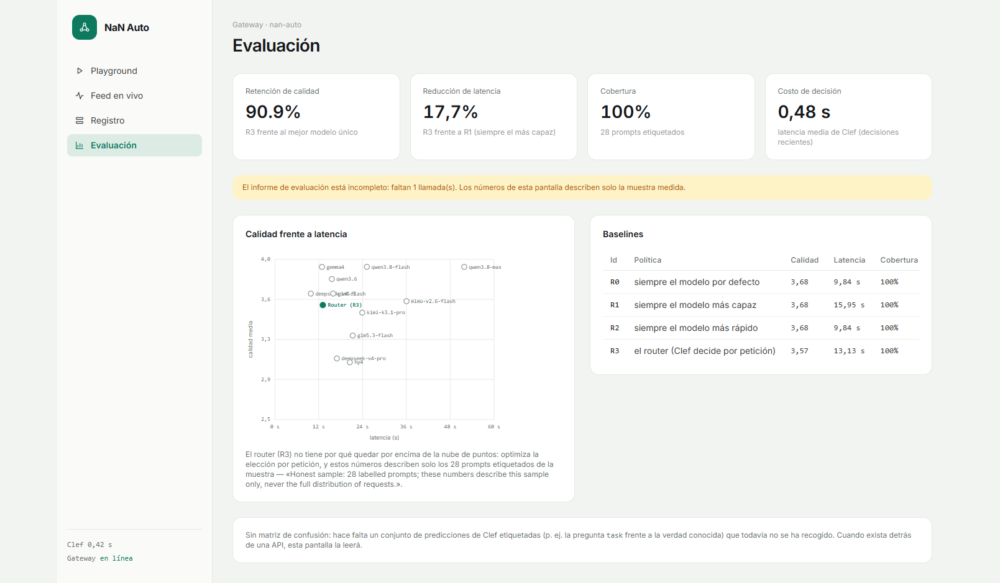
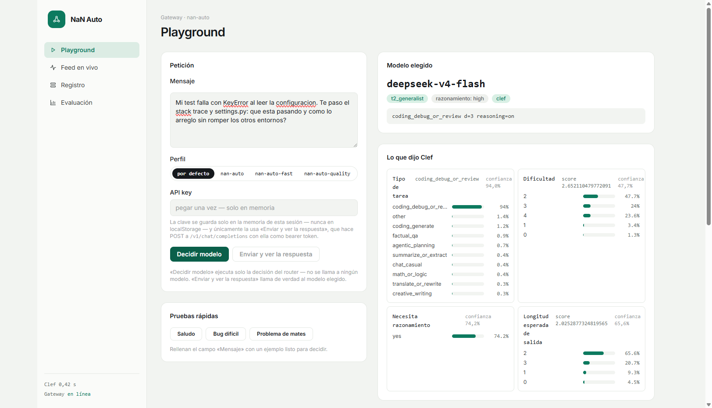
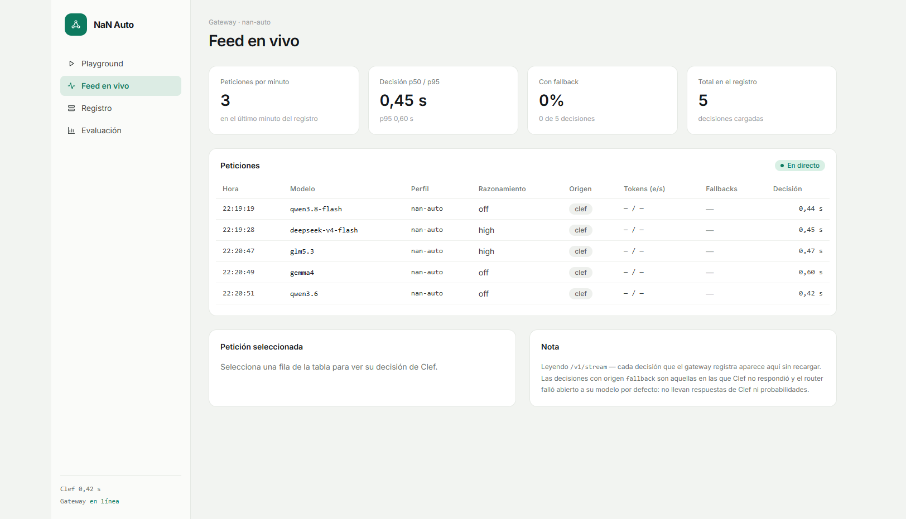
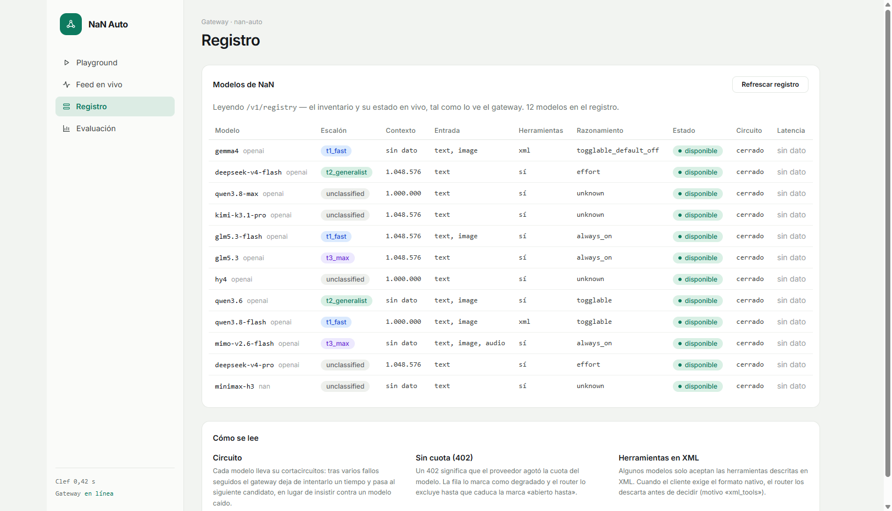

# NaN Auto

> Un endpoint OpenAI-compatible. **Clef decide, por petición, qué modelo de NaN responde y con cuánto razonamiento.**

<video src="https://github.com/aam9063/nan-auto/releases/download/demo-v1/NaN-Auto-Demo.mp4" controls muted playsinline width="100%"></video>

*La demo: Clef decide por petición, el router sirve con fallback y el dashboard lo muestra en vivo.*

`model: "nan-auto"` en cualquier cliente compatible con OpenAI (Cursor, OpenCode, Cline, Open WebUI, SDK de OpenAI): solo hay que cambiar la base URL. Detrás, el gateway extrae características deterministas de la petición, filtra por capacidades, le pregunta a **Clef** por la semántica, puntúa los candidatos y entrega la respuesta en streaming con fallback.

Build de la hackathon **#2 NaN Hackathon «Decide con Clef»** (13–15 de noviembre de 2026). El diseño completo vive en [nan-auto.md](./nan-auto.md); la metodología (ODD, RDD, Git) en su sección 15.

---

## El problema

Un catálogo con once modelos de NaN — de `qwen3.8-flash` a `glm5.3` — plantea una decisión por cada petición:

- Llamar siempre al más potente: **caro y lento** (51,8 s de latencia media medida).
- Llamar siempre al rápido: **calidad pobre** en código y matemática.
- Que el usuario elija: **fricción** y decisiones manuales que nadie quiere tomar.

Y eligiendo el modelo solo se resuelve media pregunta: varios modelos **razonan por defecto** y quemar tokens de razonamiento en «¿qué tiempo hace en Madrid?» cuesta latencia sin comprar calidad.

## La solución

NaN Auto es un **router** que toma las dos decisiones — modelo y nivel de razonamiento — por cada petición:

1. **Clef** (el LLM clasificador de NaN) responde un cuestionario de una llamada: `task`, `difficulty`, `needs_reasoning`, `expected_output_length`.
2. Un **filtro de capacidades** descarta modelos que no pueden servir la petición (imagen, tools, presupuesto premium, contexto largo, estado del circuito).
3. La **política** puntúa los candidatos con `score = fit·q − latencia·l` y elige el ganador; si Clef duda, sube un escalón (spec 6.4).
4. El **adaptador de razonamiento** traduce el nivel abstracto (`off`/`low`/`high`) a los parámetros reales de cada modelo — medidos: `gemma4` obedece `enable_thinking: false`, `deepseek-v4-flash` solo acepta `reasoning_effort`, `kimi-k3.1-pro` rechaza cualquier `temperature` explícita.
5. El **relay** transmite al upstream con la clave del cliente, con streaming SSE, cortacircuitos y cadena de fallback.

Todo queda registrado: cada decisión entra al **log** y sale por **SSE** al dashboard en vivo.

## Arquitectura



### El recorrido de una petición



### Cadena de fallback y salud de los modelos



Si el elegido está abierto o sin cuota, el router recorre la cadena de candidatos ordenada por score: el cliente nunca ve el error de un modelo caído.

## La política, afinada con datos medidos

Las constantes iniciales eran `[HIPÓTESIS]`. La matriz de calidad (abajo) las desmintió: `deepseek-v4-flash` es escalón `t2_generalist` de la tarjeta y aun así **el más rápido medido** (9,8 s); `qwen3.8-max` ni siquiera tiene escalón y es lo peor en latencia (51,8 s). La política v2 puntúa con **latencias medidas por modelo** y las filas de `chat_casual`/`factual_qa` siguen la escalera ganadora por banda de dificultad, con piso de calidad ≥ 3,8:

| Banda | Ganador medido | Latencia | Calidad |
|---|---|---|---|
| d ≤ 1 | `deepseek-v4-flash` | 2,5–4,8 s | 4,0 |
| d = 2 | `glm5.3` | 11,1 s | 4,0 |
| d = 3 | `gemma4` | 28,9 s | 4,0 |
| d ≥ 4 | `deepseek-v4-flash` | 13,7 s | 4,0 |

## Evaluación offline (NAU-14/15)



Medido contra la API real de NaN el 2026-11-14:

- **307/308 celdas** de la matriz (28 prompts × 11 modelos). La celda faltante (`en-016` × `qwen3.6`) queda documentada: el modelo piensa más que incluso 16 384 tokens y responde sin contenido.
- **Judge**: 307/307 respuestas puntuadas con rúbrica documentada; la respuesta cruda queda cacheada para auditar cualquier score.
- El reporte declara `complete: false` y la muestra exacta — **nunca se presenta una muestra como si fuera el dataset completo**.

### Resultados honestos

| Política | Modelo | Calidad | Latencia | Cobertura |
|---|---|---|---|---|
| R0 · siempre el modelo por defecto | `deepseek-v4-flash` | 3,68 | 9,84 s | 100 % |
| R1 · siempre el más capaz | `glm5.3` | 3,68 | 15,95 s | 100 % |
| R2 · siempre el más rápido | `deepseek-v4-flash` | 3,68 | 9,84 s | 100 % |
| **R3 · el router (Clef + política)** | router | 3,57 | **13,13 s** | 100 % |

El router retiene el **90,9 %** de la calidad del mejor modelo único y le gana un **17,7 % de latencia** a «siempre el más capaz», con un costo de decisión de **~0,4–0,5 s** por petición. La afirmación del spec — «el router queda por encima de la línea» — **todavía no se cumple** con esta muestra de 28 prompts, y el dashboard lo dice en pantalla en lugar de esconderlo.

[](demo/04-evaluacion.png)

## El dashboard

Cuatro pantallas sobre el gateway real, sin datos de ejemplo:

| | |
|---|---|
| [](demo/01-playground-decision.png) | [](demo/02-feed-en-vivo.png) |
| **Playground** — decidir sin llamar a ningún modelo, ver lo que dijo Clef, los candidatos con su motivo y la respuesta real con TTFT/tokens. | **Feed en vivo** — cada decisión del gateway aparece por SSE; KPIs de latencia p50/p95 y fallbacks. |
| [](demo/03-registro.png) | [](demo/04-evaluacion.png) |
| **Registro** — el catálogo en vivo con estado, circuito y razonamiento por modelo. | **Evaluación** — KPIs, dispersión calidad-latencia y baselines desde la matriz medida. |

## Cómo correrlo

```bash
# Gateway (el endpoint + el log de decisiones para el feed)
cd server
uv sync
uv run python dev_server.py --port 8010     # demo con log; o uvicorn nan_auto.gateway.app:app

# Dashboard
pnpm --dir web install
GATEWAY_URL=http://127.0.0.1:8010 pnpm --dir web dev

# Evaluación offline (sin gastar una llamada si la matriz ya está completa)
uv run --project server python eval/run.py            # baselines + Pareto desde el cache
uv run --project server python eval/run.py --dry-run  # el plan de llamadas, sin cuota
uv run --project server python eval/run.py --generate # RED: la matriz, reanudable — decisión humana
uv run --project server python eval/run.py --judge    # RED: el juez sobre las respuestas cacheadas
```

La configuración usa un `.env` local (copiar `.env.example`); la clave nunca se commitea. En el dashboard la API key se pega una vez y **vive solo en memoria de la sesión** — nunca en `localStorage` — y se usa únicamente para «Enviar», que la manda como bearer token.

## Estructura del repo

```
nan-auto/
  server/           # Python 3.14 + uv + FastAPI + Pydantic v2
    src/nan_auto/   # gateway, registry, router_core, clef_client, schema
    tests/          # pytest + pytest-asyncio + respx, fixtures/clef/
  web/              # React 19 + TSX + Vite + Tailwind CSS v4 (pnpm)
  eval/             # benchmark estilo RouterBench y evaluación offline de políticas
  config/           # models.yaml (capacidades/escalones), profiles.yaml (pesos)
  demo/             # capturas del dashboard para la demo
  odd/tasks/        # documentos de feature ODD
  docs/             # documentación del proyecto
  .githooks/        # protección pre-push de main/dev
```

## Metodología y ramas

- **ODD** (Organic Driven Development): cada feature abre su documento en `odd/tasks/` con spec literal, tareas y evidencia de verificación antes de tocar código.
- **RDD** (receipt-driven development): la entrega pasa por revisión nativa con lentes de riesgo/confiabilidad; el harness de evaluación fue revisado y aprobado, y el bloqueante que encontró el verificador (un 429 que saltaba el backoff) se corrigió con tests RED→GREEN.
- `main` — estable, lista para demo. `dev` — integración; los PRs aterrizan aquí desde `feature/*`, `fix/*`, `docs/*`. Los pushes directos a `main`/`dev` están bloqueados por `.githooks/pre-push`.

## Limitaciones honestas y siguientes pasos

- La muestra de evaluación es de **28 prompts**: describe la muestra, no la distribución completa.
- El juez es **un único modelo** (`glm5.3`) con su propio sesgo de familia; la revisión humana del 10 % está fuera del alcance de esta build. Sus fallos por fila aún no se aíslan uno a uno (follow-up).
- La **matriz de confusión** de `task` necesita predicciones de Clef etiquetadas que todavía no se recolectan.
- La política v2 deja el router **por debajo de la frontera** de modelos únicos en el Pareto: afinarla con la matriz real es el siguiente paso natural.
- La pantalla «Comparación» (dos modelos lado a lado con juez) existe en el diseño pero no tiene backend aún.

## Créditos

Construido para la #2 NaN Hackathon «Decide con Clef». Gateway y router en Python, dashboard en React, benchmark estilo RouterBench, y Clef decidiendo — como debe ser.
