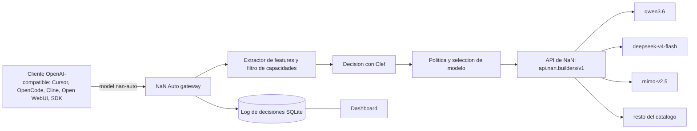
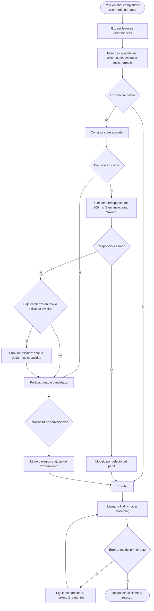
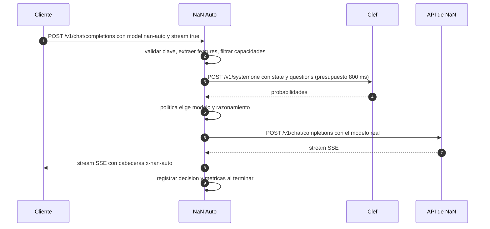
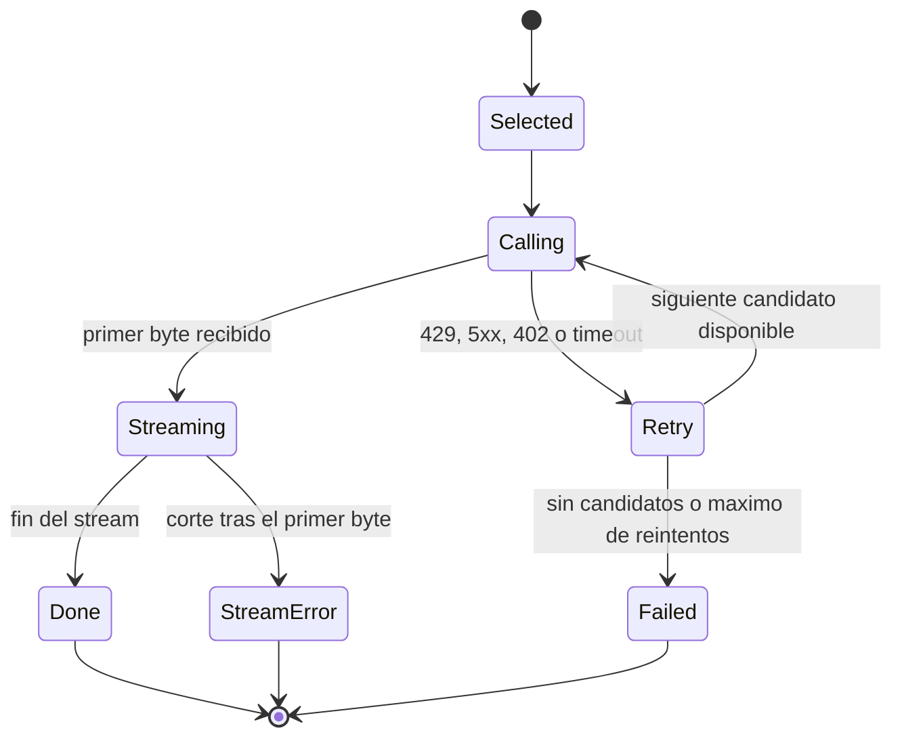
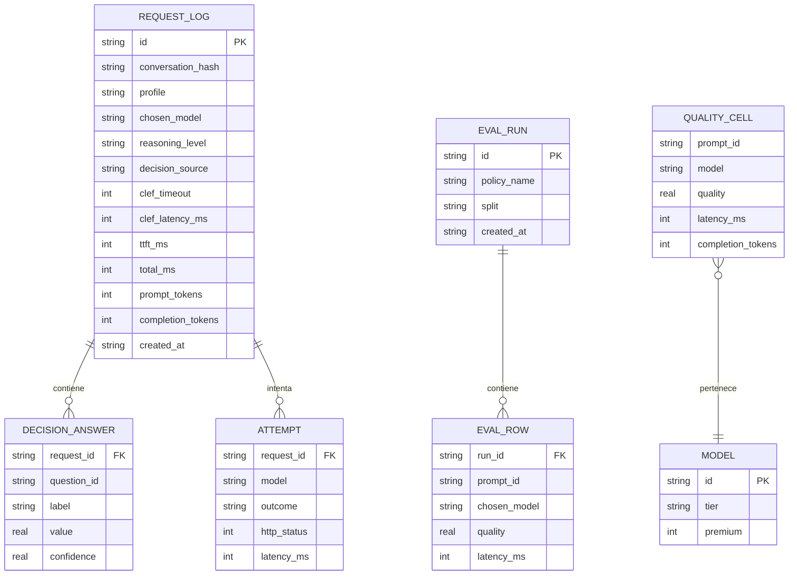
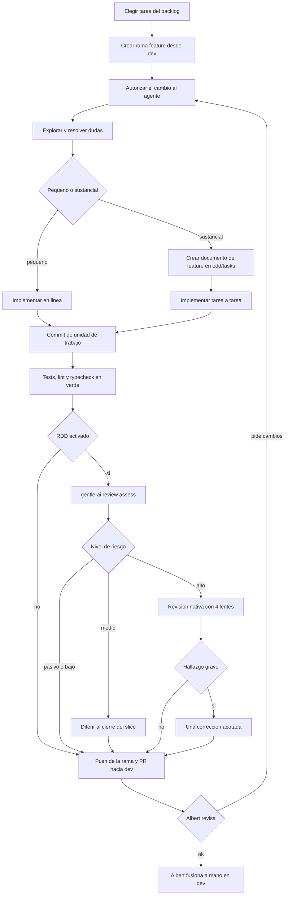
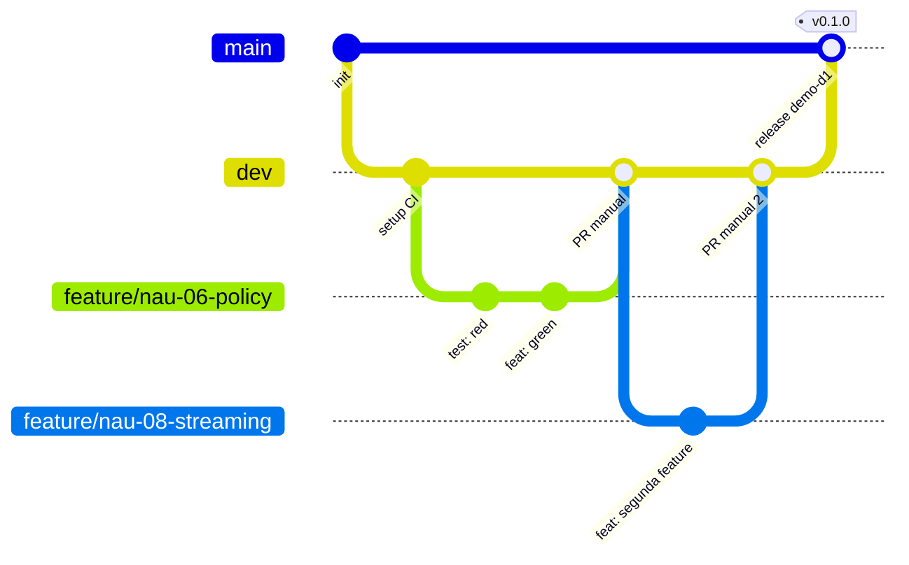

# NaN Auto

> Enrutador de modelos: un endpoint compatible con OpenAI donde Clef elige, petición a petición, qué modelo de NaN responde y con cuánto razonamiento.

| | |
|---|---|
| Categoría del reto | Enrutador de modelos |
| Hackathon | #2 NaN Hackathon "Decide con Clef": viernes 13 de noviembre de 2026 a las 17:00 al domingo 15 a las 17:00 (hora peninsular), en el Discord de NaN. Equipos de hasta 3 personas |
| Modelo de decisión | Clef a través de la API de NaN (`POST /v1/systemone`, `model: "clef"`, misma clave que los modelos de chat) |
| Estado | Diseño v2: backend en Python 3.14, contrato de Clef alineado con el README oficial del hackathon |
| Stack | Backend: Python 3.14, uv, FastAPI y Pydantic v2. Web: React 19, TSX, Tailwind CSS y pnpm |
| Metodología de trabajo | Sección 15 de este documento (ODD, RDD y Git) |
| Proyecto hermano | [aduana-de-herramientas.md](./aduana-de-herramientas.md) (alternativa, no se hacen las dos) |
| Convención | `[VERIFICAR]` marca un dato que no está confirmado en fuentes primarias. `[HIPÓTESIS]` marca una decisión de diseño que se validará con datos |

---

## 1. Resumen

**NaN Auto** es un gateway que se presenta como un modelo más: `model: "nan-auto"`. Cualquier cliente que hable con la API de NaN (Cursor, OpenCode, Cline, Continue, Open WebUI, un SDK de OpenAI) puede usarlo cambiando solo la URL base. Por detrás, para cada petición:

1. Extrae **características deterministas** (¿hay imágenes o audio?, ¿cuántos tokens?, ¿pide herramientas o JSON?).
2. Descarta los modelos que **no pueden** atenderla (filtro de capacidades en código).
3. Pregunta a **Clef** lo semántico: tipo de tarea, dificultad, necesidad de razonamiento y longitud de salida esperada.
4. Una política puntúa a los candidatos y elige **modelo + nivel de razonamiento**.
5. Hace streaming de la respuesta de NaN, con **fallback** si el modelo falla antes del primer byte.
6. Registra la decisión (sin guardar el prompt) para el dashboard y la evaluación.

**Frase para el jurado:** "NaN tiene siete modelos y cada uno es mejor en algo. Nan Auto elige el adecuado en menos de medio segundo, apaga el razonamiento cuando no hace falta y te enseña la gráfica de calidad contra latencia."

### El objetivo no es el dinero
NaN es una comunidad que comparte GPUs con planes de tarifa plana y sin facturación por token. Optimizar euros no tiene sentido. Lo que sí se optimiza:

| Objetivo | Cómo se mide |
|---|---|
| **Latencia** (primer token y total) | TTFT y tiempo total frente a "siempre el modelo más grande" |
| **Calidad suficiente** | Retención de calidad frente al mejor modelo único |
| **Cuotas escasas** | Porcentaje de peticiones que evitan modelos premium o con cuota mensual propia (los errores 402 indican cuota agotada) |
| **Carga del clúster compartido** | Tokens de razonamiento evitados en tareas triviales |

### Por qué Clef encaja aquí
- Una pregunta de enrutado es una **etiqueta de intención**, justo el tipo de tarea donde Clef destaca en los benchmarks de clasificación y enrutado de Cloudflare.
- Clef responde en 0,3 a 0,5 s solo con texto (dato de la documentación de NaN). Es un coste real que se suma al primer token, así que el router solo compensa si el modelo elegido ahorra más que eso: se mide como "sobrecarga de decisión" en la evaluación. Un LLM de chat con razonamiento tardaría bastante más.
- Devuelve **probabilidades**, así que se aplica la regla "ante la duda, subir de escalón" sin una segunda llamada.

---

## 2. Alcance

### Dentro
- Endpoint `POST /v1/chat/completions` compatible con OpenAI, con streaming SSE y paso de la clave del cliente.
- `GET /v1/models` que añade `nan-auto`, `nan-auto-fast` y `nan-auto-quality`.
- Registro dinámico de modelos desde `/v1/models` de NaN + ficha de capacidades.
- Filtro de capacidades, cuestionario Clef, política, control de razonamiento, estabilidad por conversación y fallback.
- Dashboard: playground, feed en vivo, comparación lado a lado, registro de modelos y evaluación.
- Benchmark propio en estilo RouterBench: matriz de calidad por prompt y modelo, y evaluación **offline** de cualquier política.

### Fuera (extensiones si sobra tiempo)
- Enrutado de pipelines multimodales (`whisper`, `kokoro`, `flux-2-klein`, `rerank`).
- Aprendizaje a partir de feedback de usuario o fine-tuning.
- Ejecución local de Clef con los pesos de Hugging Face (Apache 2.0), útil por privacidad.
- Autenticación multiusuario y facturación.

---

## 3. Reparto de responsabilidades

| Capa | Decide | Motivo |
|---|---|---|
| Código determinista | Visión, audio, contexto necesario, herramientas, formato de salida, disponibilidad del modelo | Son hechos de la petición. No tiene sentido preguntarlos a un modelo |
| Clef | Tipo de tarea, dificultad, necesidad de razonamiento, longitud de salida esperada | Es interpretación semántica |
| Política (código) | Puntuación de candidatos, perfil, estabilidad de conversación, fallback | Reglas editables y testeables |
| NaN | La respuesta | Los modelos |

**Si se puede decidir con código, se decide con código.** Clef se queda con lo que exige leer la intención del usuario.

---

## 4. Catálogo de modelos de NaN

Fuente: guía comunitaria de la API (septiembre de 2026). El catálogo cambia (la comunidad vota modelos cada trimestre), así que **el registro se construye al arrancar con `GET /v1/models`** y la ficha de capacidades del YAML solo aporta metadatos. Un modelo desconocido se trata como "generalista" por defecto.

| Modelo | Contexto | Entrada | Herramientas | Razonamiento (cómo se controla) | Notas |
|---|---|---|---|---|---|
| `qwen3.6` | 256K | texto, imagen | sí | Activo por defecto. `chat_template_kwargs.enable_thinking: false` lo apaga | |
| `deepseek-v4-flash` | 1M | texto, imagen (según ficha) | sí | `reasoning_effort`: low, medium, high | Punto de partida recomendado en la documentación. La prueba de visión dio `null`, verificar. No admite `json_schema`, usar `json_object` |
| `mimo-v2.5` | 1M | texto, imagen, **audio** | sí | Siempre activo, no configurable | Único con audio |
| `glm5.3` | 1M | solo texto | sí | Sin interruptor documentado | **Premium**. Orientado a coding agéntico |
| `qwen3.8-flash` | 262K | texto, imagen | sí (formato XML) | Activo, sin interruptor conocido | |
| `glm5.3-flash` | 1M | texto, imagen | sí | Siempre activo | |
| `gemma4` | 256K | texto, imagen | sí (formato XML) | Desactivado por defecto. `enable_thinking: true` lo activa | |
| `minimax-h3` | no documentado | no documentado | no documentado | | **Premium**. Excluir de la política hasta tener datos |

Otros modelos que no son de chat y quedan fuera del v1: `qwen3-embedding`, `rerank`, `kokoro` (TTS), `whisper` (STT) y `flux-2-klein` (imagen).

Puntos a tener en cuenta:
- **Premium:** solo se usan si el perfil lo permite y la clave del usuario tiene acceso. Un 402 saca al modelo de la lista hasta la renovación de la cuota.
- **Tool calling en XML** (`qwen3.8-flash`, `gemma4`): se penalizan cuando la petición lleva `tools`, salvo que se verifique que el cliente lo soporta `[VERIFICAR]`.
- **`json_schema`:** una integración comunitaria tuvo que usar `json_object` con el esquema en el prompt para `deepseek-v4-flash`. El filtro excluye el modelo o degrada el formato `[VERIFICAR]`.
- Los límites por clave (peticiones por minuto y concurrencia máxima) están publicados en la página de modelos de la documentación de NaN. El gateway lleva un limitador de concurrencia por clave.

---

## 5. Arquitectura

### 5.1 Vista de contexto



### 5.2 Componentes

| Componente | Responsabilidad | Módulo |
|---|---|---|
| Registro de modelos | Carga `/v1/models`, fusiona con `models.yaml`, mantiene salud y cuota de cada modelo | `nan_auto/registry` |
| Extractor de features | Resume la petición sin guardar el contenido | `nan_auto/router_core` |
| Filtro de capacidades | Reduce la lista de candidatos con reglas | `nan_auto/router_core` |
| DecisionProvider | Interfaz única hacia Clef: adaptadores `nan` y `mock`, con semáforo de 2 peticiones en vuelo y caché de decisiones | `nan_auto/clef_client` |
| Política | Puntúa candidatos según perfil, cuota, latencia y estabilidad | `nan_auto/router_core` |
| Adaptador de razonamiento | Traduce "razonamiento on/off/nivel" al parámetro propio de cada modelo | `nan_auto/router_core` |
| Gateway | Proxy `/v1/chat/completions` (FastAPI + httpx) con streaming, fallback, circuit breaker y limitador | `nan_auto/gateway` |
| Dashboard | Playground, feed, comparación, registro, evaluación | `web/` (React 19) |
| Benchmark y evaluación | Matriz de calidad y evaluación offline de políticas | `eval/` (scripts Python que importan `nan_auto`) |

### 5.3 Pipeline de una petición



La rama "no respondió a tiempo" hace que NaN Auto **falle abierto**: si Clef tarda, se usa el modelo por defecto del perfil y la petición no se retrasa. (En la Aduana, el guardarraíl hace justo lo contrario.)

### 5.4 Secuencia con streaming



### 5.5 Fallback y estados de una llamada



Reglas:
- Solo se cambia de modelo **antes del primer byte**. Después no se puede cambiar sin duplicar contenido, así que el error se propaga al cliente.
- Un **circuit breaker** por modelo: tras N fallos seguidos el modelo sale de la lista unos segundos. Un 402 lo saca hasta la renovación de cuota.
- Se respeta `Retry-After` en los 429.
- Un limitador de concurrencia por clave evita agotar el máximo de peticiones simultáneas de NaN. `[VERIFICAR si las peticiones a Clef y a los modelos de chat comparten el mismo límite de la clave]`

---

## 6. Contrato con Clef

Clef se llama en `POST https://api.nan.builders/v1/systemone` con `Authorization: Bearer $NAN_KEY` (la misma clave que los modelos de chat) y `model: "clef"`, el único modelo disponible. El cuerpo lleva `state` (una **cadena**, hasta unos 16k tokens) y `questions` (un objeto `id -> pregunta` con `type`, `instructions` y `criteria`).

| Límite o dato | Valor |
|---|---|
| Concurrencia | Máximo 2 peticiones a la vez por persona. Si se supera, `429`: reintentar al momento |
| Tamaño de la petición | 4 MiB |
| Latencia | 0,3 a 0,5 s solo con texto (1 a 2 s con imágenes) |
| Errores | `401` clave inválida, `429` concurrencia, `413` y `400` petición grande o mal formada (usar siempre comillas rectas `"`) |

**El formato del JSON de respuesta no está documentado.** Primera llamada de prueba con el cuestionario v1, respuesta real guardada en `server/tests/fixtures/clef/` y parser escrito contra esas fixtures `[VERIFICAR]`. Todo lo que dependa de ese formato vive en el adaptador `nan`.

Cliente de referencia (Python 3.14), basado en el ejemplo oficial `examples/clef.py` pero asíncrono. Con 3.14 las anotaciones se evalúan de forma diferida (PEP 649), así que no hace falta `from __future__ import annotations`.

```python
# server/src/nan_auto/clef_client/nan.py
import asyncio
import os

import httpx

URL = "https://api.nan.builders/v1/systemone"
_en_vuelo = asyncio.Semaphore(2)  # NaN admite 2 peticiones simultáneas por persona


async def ask_clef(client: httpx.AsyncClient, state: str, questions: dict, timeout: float = 0.8) -> dict:
    body = {"model": "clef", "state": state, "questions": questions}
    headers = {"Authorization": f"Bearer {os.environ['NAN_KEY']}"}
    async with _en_vuelo:
        for _ in range(5):
            r = await client.post(URL, json=body, headers=headers, timeout=timeout)
            if r.status_code == 429:  # demasiadas en vuelo: reintentar al momento
                await asyncio.sleep(0.2)
                continue
            r.raise_for_status()
            return r.json()
    raise RuntimeError("Clef: 429 sostenido")
```

### 6.1 Features deterministas (no van a Clef)

| Feature | Origen |
|---|---|
| `has_image`, `has_audio` | Partes de contenido del mensaje (`image_url`, `input_audio`) |
| `est_tokens` | Estimación sobre todos los mensajes |
| `has_tools`, `tool_choice` | Campo `tools` de la petición |
| `response_format` | `text`, `json_object` o `json_schema` |
| `stream` | Campo `stream` |
| `turns`, `has_code_fences` | Recuento y heurística simple |
| `conversation_key` | Cabecera `x-conversation-id` o hash de system prompt + primer mensaje |

### 6.2 State enviado a Clef

El texto se **acota**: Clef admite unos 16k tokens, pero cada token extra cuesta latencia y un prompt de usuario puede ser enorme. `state` es una cadena: este objeto se serializa a JSON compacto antes de enviarlo.

```json
{
  "last_user_message_head": "...maximo 600 tokens...",
  "last_user_message_tail": "...maximo 200 tokens...",
  "system_prompt_head": "...maximo 150 tokens...",
  "meta": { "turns": 7, "has_code_fences": true, "language_hint": "es" }
}
```

### 6.3 Cuestionario v1

| Id | Tipo | Instrucción | Criterios |
|---|---|---|---|
| `task` | `choice` | ¿Qué tipo de tarea pide el usuario en su último mensaje? | `chat_casual`, `factual_qa`, `coding_generate`, `coding_debug_or_review`, `math_or_logic`, `summarize_or_extract`, `translate_or_rewrite`, `creative_writing`, `agentic_planning`, `other` con una descripción corta cada una |
| `difficulty` | `score` | ¿Qué dificultad tiene la tarea para un modelo de lenguaje? | `["Trivial","Fácil","Media","Difícil","Experta"]` |
| `needs_reasoning` | `noul` | ¿La tarea exige razonar paso a paso para dar una respuesta correcta? | |
| `expected_output_length` | `score` | ¿Qué longitud tendrá la respuesta esperada? | `["Muy corta","Corta","Media","Larga"]` |

Una sola llamada, cuatro preguntas. Se espera una probabilidad por opción en `choice`, una distribución por nivel en `score` y la probabilidad de "sí" en `noul`, pero los nombres de los campos se confirman con las fixtures reales. (Las respuestas cercanas a 0,5 suelen indicar una pregunta ambigua. Se revisan los criterios, no se culpa al modelo.)

### 6.4 Zona de duda y concurrencia

1. Se hace **una** llamada a Clef con las cuatro preguntas.
2. Si `task.confidence < 0.60`, o si la distribución de `difficulty` está repartida entre "fácil" y "difícil" (masa de probabilidad alta en ambos extremos), no hay segunda consulta: la política aplica **ante la duda, subir de escalón** (más capacidad, no menos).
3. NaN admite 2 peticiones a Clef en vuelo por persona. El gateway usa un semáforo de 2 por clave y una cola. Si la espera más la llamada superan `DECISION_TIMEOUT_MS` (800 ms por defecto, por encima de la latencia de 0,3 a 0,5 s), se usa el modelo por defecto del perfil y la petición no se retrasa (falla abierto).
4. Techo teórico: con 2 en vuelo y 0,3 a 0,5 s por llamada salen unas 4 a 6 decisiones por segundo por clave `[HIPÓTESIS]`. Basta para la demo. Para reducir llamadas: caché de decisiones por hash del último mensaje y estabilidad por conversación (sección 7).
5. Se mide en la evaluación cuánta calidad se pierde por ir al modelo por defecto cuando Clef no llega a tiempo.

---

## 7. Política de selección

### 7.1 Escalones de modelos `[HIPÓTESIS]`

| Escalón | Modelos | Uso |
|---|---|---|
| T1 rápido | `gemma4`, `qwen3.8-flash`, `glm5.3-flash` | Conversación y tareas simples |
| T2 generalista | `qwen3.6`, `deepseek-v4-flash` | Mayoría de peticiones |
| T3 máxima capacidad | `glm5.3` (premium), `mimo-v2.5` (multimodal) | Difíciles, coding agéntico, audio |

Los escalones salen de los tamaños y de las notas de las fichas, **no de medidas**. La matriz de calidad real (primeras horas del hackathon) los sustituye.

### 7.2 Tabla de decisión inicial `[HIPÓTESIS]`

| Tarea | Dificultad | Candidatos (en orden) | Razonamiento |
|---|---|---|---|
| `chat_casual`, `factual_qa` | 0 a 1 | T1 | off |
| `chat_casual`, `factual_qa` | 2 | T2 | off |
| `translate_or_rewrite` | 0 a 2 | T1, T2 | off |
| `summarize_or_extract` | cualquiera | Si hay contexto largo: `deepseek-v4-flash`, `glm5.3-flash`. Si no, T1 o T2 | off |
| `creative_writing` | cualquiera | T2 | off |
| `coding_generate` | 0 a 2 | T2 | off o low |
| `coding_generate` | 3 a 4 | `glm5.3` si el perfil lo permite, si no `deepseek-v4-flash` con high o `qwen3.6` con razonamiento | on |
| `coding_debug_or_review` | 2 a 4 | T2 o T3 | on |
| `math_or_logic` | 2 a 4 | T2 o T3 | on |
| `agentic_planning` o `has_tools` | cualquiera | T2 o T3 (evitar modelos con tool calling XML sin verificar) | según `needs_reasoning` |

### 7.3 Puntuación (v2, tras el benchmark)

```
score(m) = fit[m][task] * q_weight
         - latency_tier[m] * l_weight
         - quota_penalty[m]
         - switch_penalty(m, conversacion)
```

- `fit[m][task]`: calidad medida en la matriz de calidad (sección 11).
- `latency_tier[m]`: de la latencia medida en el benchmark.
- `quota_penalty[m]`: penaliza modelos premium o con poca cuota restante.
- `switch_penalty`: penaliza cambiar de modelo a mitad de conversación.

| Perfil | `q_weight` | `l_weight` | Premium | Razonamiento |
|---|---|---|---|---|
| `nan-auto` (balanceado) | 1.0 | 0.5 | Solo si dificultad ≥ 3 | Según `needs_reasoning` |
| `nan-auto-fast` | 0.6 | 1.0 | No | Off salvo dificultad ≥ 4 |
| `nan-auto-quality` | 1.0 | 0.2 | Sí | On si dificultad ≥ 2 |

Los pesos son iniciales y se ajustan con el split de desarrollo.

### 7.4 Control del razonamiento

El router traduce un nivel abstracto (`off`, `low`, `medium`, `high`) al parámetro de cada modelo mediante un adaptador:

| Modelo | Traducción |
|---|---|
| `qwen3.6` | `chat_template_kwargs: { enable_thinking: false | true }` |
| `deepseek-v4-flash` | `reasoning_effort: low | medium | high` |
| `gemma4` | `chat_template_kwargs: { enable_thinking: true }` solo para `on` |
| `mimo-v2.5`, `glm5.3-flash` | Siempre activo, sin cambio |
| `qwen3.8-flash`, `glm5.3` | Sin interruptor documentado, sin cambio |

Apagar el razonamiento en tareas simples es probablemente la mayor palanca de latencia. Se mide con y sin en el benchmark.

### 7.5 Estabilidad por conversación

Cambiar de modelo en cada turno rompe el estilo y pierde la caché de prefijo del servidor. Por eso se mantiene el modelo anterior de la conversación (memoria LRU con caducidad de 30 minutos) **salvo que**:
- el filtro de capacidades lo excluya (llega una imagen o un audio);
- la dificultad suba al menos dos niveles o la tarea cambie de casual a coding o matemáticas;
- el modelo anterior haya fallado o esté con el circuit breaker abierto.

---

## 8. API del gateway

| Método y ruta | Descripción |
|---|---|
| `POST /v1/chat/completions` | Compatible con OpenAI. Con `model: "nan-auto"`, `"nan-auto-fast"` o `"nan-auto-quality"` enruta. Con otro modelo, reenvía sin tocar nada |
| `GET /v1/models` | Lista los modelos de NaN y añade los tres alias de NaN Auto |
| `GET /v1/decisions` y `GET /v1/decisions/:id` | Historial y detalle con probabilidades (para el dashboard) |
| `POST /v1/playground/decide` | Solo decide, no llama al modelo. Devuelve la elección y las probabilidades |
| `GET /v1/stream` | SSE con las decisiones en vivo |
| `GET /v1/registry` | Estado de los modelos: disponibles, salud, cuota |
| `POST /v1/eval/run` | Lanza una evaluación offline de una política |

### Cabeceras de respuesta
- `x-nan-auto-model`: modelo real usado.
- `x-nan-auto-decision-id`: id para consultar el detalle.
- `x-nan-auto-reason`: motivo corto (por ejemplo `coding_generate d=3 reasoning=on`).
- `x-nan-auto-fallback`: modelos intentados antes del definitivo, si hubo.

### Extensión opcional del cuerpo
```json
{
  "model": "nan-auto",
  "messages": [{ "role": "user", "content": "Explica este stack trace..." }],
  "stream": true,
  "nan_auto": { "profile": "fast", "explain": true, "allow_premium": false }
}
```
El campo `nan_auto` se elimina antes de reenviar a NaN.

### Claves
El cliente envía su clave de NaN en `Authorization`. El gateway la **reenvía** y nunca la guarda ni la escribe en logs. Hay dos modos:
- **Local** (recomendado): cada usuario ejecuta el gateway en su máquina con `npx`. Las claves y los prompts no salen de ahí.
- **Demo alojado**: una instancia con la clave del equipo y límites estrictos, solo para el jurado.

---

## 9. Modelo de datos



Por defecto **no se guarda el contenido de los prompts** ni de las respuestas: solo características, probabilidades, tiempos y tokens (el contenido solo se guarda en el dataset de evaluación, que contiene prompts sintéticos o públicos). Es coherente con la propuesta de valor de NaN: sin registro de prompts.

---

## 10. Dashboard

| Pantalla | Contenido |
|---|---|
| **Playground** | Cajón de texto y adjuntos. Muestra las probabilidades de Clef por pregunta, los candidatos descartados con el motivo, la puntuación y el modelo elegido. Botón "enviar" para ver la respuesta real |
| **Feed en vivo** | Peticiones en tiempo real con modelo, razonamiento, TTFT, total, fallbacks |
| **Comparación** | Mismo prompt enviado a la elección del router y a una referencia (por ejemplo, el modelo más grande), en paralelo. Muestra TTFT, tiempo total, tokens y las dos respuestas. Veredicto opcional de un juez |
| **Registro** | Estado de cada modelo: disponible, salud, cuota, escalón |
| **Evaluación** | Gráfica de Pareto de calidad frente a latencia, tabla de baselines, matriz de confusión de `task` |

Stack (carpeta `web/`): React 19 con TypeScript (TSX), Vite y Tailwind CSS v4, gestionado con pnpm. SSE con `EventSource` para tiempo real. Los tipos de la API se generan desde el OpenAPI de FastAPI (`openapi-typescript`), de modo que los esquemas Pydantic son la única fuente de verdad.

---

## 11. Evaluación

### 11.1 Dos datasets

1. **Etiquetas de intención** (`eval/data/intents.jsonl`, 150 a 200 prompts): cada prompt con `task` y `difficulty` etiquetados por personas. Mide la precisión de Clef como clasificador. Incluye prompts en español e inglés, cortos y largos, con código y con adjuntos.
2. **Matriz de calidad** (`eval/data/quality.parquet` o SQLite): para cada prompt, la respuesta de **cada modelo** del catálogo, con calidad puntuada, latencia y tokens. Se genera **una vez**.

### 11.2 Evaluación offline (estilo RouterBench)

Con la matriz de calidad ya calculada, **cualquier política se evalúa sin nuevas llamadas**: para cada prompt se consulta qué modelo habría elegido y se lee su calidad y latencia de la matriz. Esto permite iterar sobre umbrales y pesos en segundos.

### 11.3 Cómo se puntúa la calidad
- Juez LLM de NaN, por pares frente a una respuesta de referencia, con rúbrica escrita y **orden aleatorizado** para reducir sesgo de posición.
- Para tareas verificables (código con tests, matemáticas con respuesta, extracción con campos) se usa corrección automática, sin juez.
- Revisión humana de una muestra del 10% para detectar sesgo del juez.
- Al ser todos los candidatos modelos de NaN, el juez puede favorecer a su propia familia. Se documenta como limitación.

### 11.4 Baselines

| Id | Política |
|---|---|
| R0 | Siempre `deepseek-v4-flash` (el punto de partida recomendado por NaN) |
| R1 | Siempre el modelo más capaz |
| R2 | Siempre el más rápido |
| R3 | Aleatoria |
| R4 | Reglas (palabras clave y longitud) |
| R5 | Router con LLM: un modelo de chat de NaN elige y responde en JSON |
| R6 | Clef + política (producto final) |
| R7 | Clef + política con caché de decisiones y presupuesto de 800 ms (producto final con las condiciones reales de concurrencia) |

### 11.5 Métricas

| Métrica | Definición |
|---|---|
| Retención de calidad | Calidad media del router / calidad media del mejor modelo único |
| Reducción de latencia | Latencia media frente a "siempre el más capaz" |
| Peticiones premium evitadas | Porcentaje que no usa modelos premium |
| Precisión de `task` y error absoluto de `difficulty` | Frente a las etiquetas humanas |
| Sobrecarga de decisión | Latencia p50 y p95 de la decisión |
| Tasa de fallback | Porcentaje con al menos un reintento |

**Gráfica principal:** latencia en el eje X y calidad en el Y. Cada modelo único es un punto. El router debería quedar **por encima de la línea** que une a los modelos únicos (más calidad con menos latencia). Esa imagen es el argumento de la demo.

### 11.6 Límites de ejecución del benchmark
Generar la matriz implica del orden de `prompts x modelos` llamadas (por ejemplo 150 x 7 = 1.050 completados, más el juez). Hay que respetar los límites por clave de NaN con un limitador de concurrencia y reintentos con backoff. Se lanza en la Fase 0 y se cachea en disco.

---

## 12. Seguridad y privacidad

| Tema | Decisión |
|---|---|
| Claves | Reenvío sin almacenamiento, redacción de cabeceras en logs, nunca en el dashboard |
| Contenido | No se guarda por defecto. Solo features, probabilidades y métricas. `LOG_CONTENT=true` solo para depurar en local |
| Proveedor de Clef | El texto acotado del prompt viaja a la API de NaN, la misma plataforma que recibe el prompt completo al responder. Con `mock`, nada sale. NaN se presenta como zero-log `[VERIFICAR]` |
| Abuso del modo alojado | Límite de peticiones por IP y por clave, tope de tokens por petición, sin apertura pública |
| Inyección en el prompt | Clef es un clasificador y no obedece instrucciones del texto. El peor caso es una mala elección de modelo, no una acción. Se mide con casos adversarios |
| Cabecera `nan_auto` | Se valida con esquema y se elimina antes de reenviar |

---

## 13. Stack y estructura del repositorio

**Stack:** Python 3.14 en el backend (gestionado con uv), FastAPI con uvicorn, Pydantic v2, httpx asíncrono (streaming), SQLite (`aiosqlite`), pytest con pytest-asyncio y respx, ruff y pyright. La web es una SPA aparte con React 19, TSX, Vite, Tailwind CSS v4 y pnpm.

Versiones mínimas con soporte de 3.14 anunciado: Pydantic 2.12, FastAPI 0.118.3, uvicorn 0.38 y ruff 0.14.2 `[VERIFICAR versiones el primer día]`. Se usa el intérprete estándar con GIL: el modo free-threaded (PEP 779) no hace falta y FastAPI aún no lo declara `[VERIFICAR]`.

Arranque rápido del backend:

```bash
uv python install 3.14
uv init --package --python 3.14 server
cd server
uv add fastapi "uvicorn[standard]" pydantic httpx aiosqlite pyyaml
uv add --dev pytest pytest-asyncio respx ruff pyright
```

Arranque rápido de la web (pnpm, React 19, Vite y Tailwind CSS) `[VERIFICAR versiones el primer día]`:

```bash
pnpm create vite web --template react-ts
pnpm --dir web add tailwindcss @tailwindcss/vite
pnpm --dir web add -D openapi-typescript
# vite.config.ts: añadir tailwindcss() a plugins y un proxy de /v1 hacia http://localhost:8000
# src/index.css: @import "tailwindcss";
```

```
nan-auto/
  server/
    pyproject.toml            # uv, ruff, pyright, pytest
    src/nan_auto/
      gateway/                # FastAPI: /v1/*, streaming, fallback, SSE
      registry/               # modelos, salud, cuota
      router_core/            # features, filtro, politica, adaptador de razonamiento
      clef_client/            # DecisionProvider: nan, mock (semaforo de 2, cache)
      schema/                 # modelos Pydantic: peticion, decision, registro
    tests/
      fixtures/clef/          # respuestas reales capturadas de Clef
  web/                        # React 19 + TSX + Vite + Tailwind CSS (pnpm)
  eval/
    data/intents.jsonl
    bench/                    # generador de la matriz de calidad
    run.py
  config/
    models.yaml               # metadatos de capacidades y escalones
    profiles.yaml
  odd/tasks/
  docs/
  .githooks/
```

Variables de entorno: `CLEF_PROVIDER` (`nan` | `mock`), `NAN_KEY` (clave de NaN para las decisiones de Clef en la demo alojada y el benchmark; en uso normal se reutiliza la clave del cliente), `NAN_BASE_URL` (por defecto `https://api.nan.builders/v1`), `DEFAULT_MODEL`, `DECISION_TIMEOUT_MS` (800), `CLEF_MAX_IN_FLIGHT` (2).

El adaptador `mock` clasifica con reglas simples y permite desarrollar, probar en CI y ensayar sin red.

---

## 14. Backlog inicial (para ODD)

"Riesgo RDD" es la expectativa para la revisión nativa. Todo lo que toca claves, streaming y fallback se considera de riesgo alto.

| Id | Tarea | Criterio de aceptación | Riesgo RDD |
|---|---|---|---|
| NAU-01 | Estructura del repo (`server/` con uv, `web/` con pnpm) y CI (ruff, pyright, pytest, lint de la web) | `uv run pytest` verde en CI sobre PR a `dev` | Bajo |
| NAU-02 | `DecisionProvider`: cliente `nan` (semáforo de 2, reintento en 429) y `mock`. Primera llamada real y fixtures | Misma interfaz, parser probado con fixtures de respuesta real | Medio |
| NAU-03 | Registro de modelos desde `/v1/models` + `models.yaml` | Un modelo nuevo aparece sin tocar código | Medio |
| NAU-04 | Extractor de features | Casos de imagen, audio, tools, formato y tokens | Medio |
| NAU-05 | Cuestionario Clef v1 + `state` acotado | Snapshot del cuestionario, recorte de textos largos | Medio |
| NAU-06 | Filtro de capacidades y política v1 (tabla) | Tabla de decisión cubierta con tests | Medio |
| NAU-07 | Proxy `chat/completions` sin streaming | Cliente OpenAI funciona con `nan-auto` | **Alto** |
| NAU-08 | Streaming SSE de extremo a extremo y cabeceras `x-nan-auto` | Cursor u OpenCode funcionan con `nan-auto` | **Alto** |
| NAU-09 | Adaptador de razonamiento por modelo | Test por modelo del parámetro enviado | Medio |
| NAU-10 | Fallback, circuit breaker y limitador de concurrencia | Simulación de 429, 5xx y 402 | **Alto** |
| NAU-11 | Presupuesto de decisión (800 ms), cola de 2 en vuelo y falla abierta | Timeout simulado cae al modelo por defecto | Medio |
| NAU-12 | Estabilidad por conversación | No cambia de modelo sin causa | Medio |
| NAU-13 | Log de decisiones sin contenido + SSE | Ningún prompt ni clave en la base de datos (test) | **Alto** |
| NAU-14 | Benchmark: dataset y matriz de calidad | Matriz completa, cacheada y reproducible | Medio |
| NAU-15 | Harness de evaluación offline y baselines | `uv run python eval/run.py` genera tabla y gráfica de Pareto | Medio |
| NAU-16 | Dashboard: playground y feed | Se ve la decisión con probabilidades | Bajo |
| NAU-17 | Dashboard: comparación lado a lado y evaluación | Pareto visible y comparación en vivo | Bajo |
| NAU-18 | Pruebas de contrato del cliente `nan` (`429`, `401`, timeout) y caché de decisiones | Fixtures reales. Un prompt repetido no vuelve a llamar a Clef | Medio |
| NAU-19 | README, badge "Built with NaN", guion y vídeo | Un tercero lo levanta con 3 comandos | Bajo |

---

## 15. Metodología de trabajo: ODD, RDD y Git

Se da por hecho que **gentle-ai y gentle-shell ya están instalados** y que **el repositorio ya existe** (con `main` y `dev`) cuando empieza el hackathon. Esta sección fija cómo se trabaja con ellos y cómo viaja el código hasta `main`, **sin ningún merge automático: fusiona Albert, a mano.**

### 15.1 Principios

1. **Un humano decide qué se fusiona.** Ningún agente, workflow ni regla de GitHub fusiona nada por su cuenta.
2. **Lectura primero.** Preguntas, revisiones y propuestas son de solo lectura. Un agente solo cambia código cuando se le autoriza de forma explícita.
3. **Lo pequeño se queda pequeño.** Lo entendido se hace en línea. Solo el trabajo sustancial deja un registro recuperable.
4. **Se demuestra, no se narra.** Una casilla se marca con evidencia observada: test en rojo y luego en verde, salida de comandos, hash de commit.
5. **Revisión proporcional al riesgo.** RDD revisa a fondo lo que puede hacer daño y deja pasar lo trivial.
6. **Ramas cortas y PRs pequeños** (orientativamente unas 400 líneas de cambio).
7. **Un dueño por pieza.** Cada paquete y cada documento de feature tiene una sola persona responsable.

### 15.2 Comprobaciones al empezar

```bash
gentle-ai doctor
gentle-ai review mode status --cwd .   # ¿RDD activo y desde qué fuente?
gentle-ai sync --dry-run               # no debe quedar nada del SDD antiguo
```

Lo que debe estar en el repositorio. Si falta algo, se añade en una rama `chore/bootstrap` y lo fusiona Albert:

- [ ] `main` y `dev` protegidas según 15.7 y "Allow auto-merge" desactivado.
- [ ] `.githooks/pre-push` activo (`git config core.hooksPath .githooks`).
- [ ] CI de comprobación, `CODEOWNERS` y plantilla de PR (plantillas en 15.9).
- [ ] Carpeta `odd/tasks/` creada y `.env` en `.gitignore`.
- [ ] Cada persona sabe con qué runtime trabaja: la guía de RDD llega a Claude Code, Codex y OpenCode. En Pi, el prompt lo gestiona gentle-shell.

### 15.3 ODD: Organic Driven Development

ODD autoriza y entiende una petición. El trabajo de solo lectura termina por separado. El autorizado se queda ligero si es pequeño o guarda un registro recuperable si es sustancial, y después se implementa, se comprueba y se cierra.

#### Las siete fases

| # | Fase | Qué ocurre |
|---|---|---|
| 1 | **Autorizar** | Se decide si la petición autoriza un cambio. Preguntas, revisiones y propuestas siguen siendo de solo lectura |
| 2 | **Explorar** | Se examina el código y los requisitos, a la medida de la petición |
| 3 | **Resolver incertidumbre** | Investigación para una duda concreta, **una** pregunta enfocada si hay una decisión de producto real y, como máximo, un desafío de premisa si es de alto impacto |
| 4 | **Clasificar** | Pequeño o sustancial |
| 5 | **Registrar antes de la primera escritura** | Si es sustancial: se crea el documento de feature y su espejo en Engram antes de tocar código |
| 6 | **Implementar tarea a tarea** | Por la topología más pequeña útil, con el modo TDD configurado y las comprobaciones aplicables. Cada tarea termina con al menos un commit de unidad de trabajo |
| 7 | **Cerrar** | Resultado verificado, cada comprobación fallida o pendiente y el siguiente paso |

#### Pequeño o sustancial
- **Sustancial:** la exploración revela dos o más pasos de implementación significativos, o hay progreso que merece poder recuperarse (varias sesiones, esperas externas, requisitos largos que no sobreviven a la compactación del contexto).
- **Pequeño y entendido:** no crea artefactos duraderos. Se hace en línea.
- El tamaño se mide por **comprensión, riesgo y capacidad de reanudar**, no por número de ficheros.

Aquí, cada fila del backlog (`NAU-xx`) con más de un paso real es **sustancial** y tiene su documento de feature.

#### Enrutado: en línea o delegado
Por defecto se trabaja **en línea**. Solo se delega con un motivo con nombre:

| Motivo | Cuándo |
|---|---|
| Exploración | Entender algo requiere más de unas 3 llamadas a herramientas o unos 10.000 tokens. Va a un explorador de solo lectura |
| Escritores en paralelo | Dos o más unidades de comportamiento independientes, con superficies de edición que no se solapan |
| Respaldo de contexto | Una sesión larga entrega la siguiente unidad a un trabajador nuevo |
| Verificador independiente | El cambio toca algo de alto riesgo con nombre, sea cual sea el modelo que lo escribió |

El número de ficheros o el tamaño de la tarea **no** bastan para delegar. Ante la duda, el agente principal trabaja en línea. Cada traspaso apunta al documento de feature en lugar de parafrasear la especificación.

#### El documento de feature
- **Ubicación:** `odd/tasks/<nombre-de-feature>.md`, versionado en la rama de la feature.
- **Espejo en Engram:** tema `odd/<nombre-de-feature>/tasks`, con el documento completo y su ruta.
- **Contenido:** objetivo, problema, motivo, alcance, restricciones, lista de tareas con identificadores estables y criterios de aceptación, evidencia, progreso y siguiente paso. Guarda tu especificación **literal**.
- **Cambios:** los cambios aceptados actualizan intención y tareas a la vez. Un hallazgo no autoriza por sí solo ampliar el alcance.
- **Escrituras no atómicas:** se lee de vuelta cada escritura (fichero y espejo). Si Engram no está disponible, se conserva el progreso local y se informa del espejo pendiente.

Plantilla en 15.9.

#### Test-first
Se aplica por defecto cuando hay un test ejecutable relevante y un resultado esperado claro: **RED** (test de comportamiento que falla, observado), **GREEN** (lo mínimo para que pase) y **REFACTOR** (limpieza con los tests en verde).

- Cada regla pedida tiene **un** test en rojo.
- Cada comando u opción existente que se toca tiene **un** test que prueba que su comportamiento previo se mantiene.
- Sin test ejecutable significativo, el agente explica la excepción y ejecuta las comprobaciones funcionales aplicables.
- Que existan tests no activa el TDD por sí solo: el modo se resuelve desde la configuración o una decisión explícita, y se registran la fuente y el runner en el documento de feature.

| Zona | Modo | Runner |
|---|---|---|
| `schema`, `clef_client`, `registry`, `router_core`, `gateway`, `eval` | TDD activado | `uv run pytest` |
| `web`, scripts de benchmark y de demo | Excepción documentada | `pnpm --dir web typecheck && pnpm --dir web build` más una prueba de humo manual |

#### Commits de unidad de trabajo
- Cada tarea cierra con **al menos un commit** en la rama de la feature. Si el trabajo empieza en la rama por defecto, primero se crea una rama.
- Tests y documentación van en el **mismo commit** que el comportamiento, con mensaje de Conventional Commits.
- El documento de feature registra el identificador de cada commit como evidencia.
- La unidad de revisión nativa es un commit de unidad de trabajo o un slice de PR, **nunca** una casilla de la lista ni la rama completa.

#### Estrategia de entrega
ODD ofrece cuatro estrategias: `ask-on-risk` (por defecto), `auto-chain`, `single-pr` y `exception-ok`. Pasadas unas 400 líneas se aplica la estrategia antes del siguiente commit.

**Nuestra elección:**
- **`ask-on-risk`**: el agente pregunta antes de partir un PR o de encadenarlo.
- **Base de todo PR: `dev`**, nunca `main`. Por eso no se usa `stacked-to-main`. Si una feature necesita encadenar PRs, se usa `feature-branch-chain` y Albert indica a qué rama apunta cada uno.
- Los límites de los slices (qué commits contiene cada PR) se anotan en el documento de feature.

#### Reanudar una tarea
1. Antes de implementar o retomar, el agente principal lee la observación completa de Engram **y** el fichero real de tareas.
2. Concilia el código actual con la evidencia registrada.
3. Pasa el localizador y el contexto al trabajador, que lee el documento antes de editar.
4. Si hay versiones en conflicto, se conservan; no se sobrescribe una en silencio.

#### Cómo hablarle al agente
**Explorar (solo lectura)**
```
Solo lectura. Explora <zona> y dime cómo está montado <asunto>. No cambies nada.
```
**Autorizar un cambio**
```
Implementa NAU-10 según odd/tasks/nau-10-fallback.md. TDD activado con "uv run pytest".
Un commit convencional por tarea, con tests en el mismo commit.
Trabaja en la rama actual. No hagas merge ni push a dev o main.
```
**Retomar**
```
Retoma odd/tasks/nau-10-fallback.md. Lee el documento y su espejo en Engram,
concilia con el código y dime en qué punto estamos antes de seguir.
```
**Cerrar**
```
Cierra NAU-10: lista las comprobaciones pasadas, falladas o pendientes y el siguiente paso.
```

### 15.4 RDD: Receipt-Driven Development

Un agente dice "lo he arreglado y los tests pasan" y no hay forma de comprobarlo sin leer todo el diff. RDD sustituye la narración del agente por **evidencia que el sistema puede derivar de forma independiente**.

#### Qué es y qué no es
- Revisa un **candidato de cambio** terminado, sin asumir la propiedad de la entrega.
- Un reviewer independiente y de solo lectura examina una copia inmutable, no el árbol vivo.
- **Aprobar nunca hace commit, push, PR ni release.** Esas decisiones siguen la política normal del repositorio y son tuyas. Encaja con el principio 1.
- Es **opcional** y se puede apagar. Desactivarlo deja intactas las comprobaciones ordinarias.
- ODD nunca activa RDD: el interruptor es del usuario.

#### Ciclo de una revisión
1. **STATUS** (sin selector): evalúa el árbol de trabajo y propone una invocación START exacta.
2. **START**: congela el candidato (linaje, revisión y destino), clasifica el riesgo una sola vez y elige las lentes.
3. **Recogida acotada:** los reviewers devuelven JSON estricto. Nadie edita ficheros ni avanza el estado.
4. **Aprobación:** se lee la aprobación terminal y se **quema** el linaje. Un linaje quemado no se reutiliza.
5. Vuelve la política ordinaria del repositorio: tú decides si hay commit, push o PR.

Un resultado inconcluso (salida malformada, fallo de transporte, ambigüedad) **no** es aprobación. En la interacción normal solo verás cuatro estados: **Working**, **Checking**, **Ready** y **Needs your decision**.

#### Riesgo y lentes
El riesgo se clasifica una vez al congelar el candidato y no cambia con las correcciones. Los nombres de los niveles varían un poco entre versiones de la documentación.

| Nivel | Lentes | Comportamiento |
|---|---|---|
| Pasivo o bajo | 0 | Lectura estructural, en silencio, sin preguntas |
| Medio o estándar | 1 lente enfocada | Una pasada enfocada, con consentimiento |
| Alto | Las 4R: **Risk, Resilience, Readability, Reliability** | Consentimiento y previsión de coste |

Una revisión automática solo vence para candidatos de **alto** riesgo. El agente puede nombrar solo las lentes que encajan con lo que tocó, con una razón.

#### Corrección acotada
- Solo los hallazgos **graves causados por el candidato** pueden bloquear. Los preexistentes pasan a seguimientos. WARNING y SUGGESTION son informativos.
- Una revisión ordinaria permite **exactamente una corrección**, con presupuesto fijado al empezar: el menor entre 200 líneas y la mitad de las líneas originales cambiadas, redondeada hacia arriba.
- Un validador de solo lectura comprueba el arreglo. Aceptado el intento, la corrección queda agotada: cualquier cambio posterior requiere un sucesor autorizado.

#### Después de cada commit
```bash
gentle-ai review assess --cwd . --base-ref <ultimo-limite-revisado> --committed-only --json
```

| Nivel devuelto | Acción |
|---|---|
| Pasivo o bajo | Silencio. El límite avanza |
| Medio | Se difiere al **cierre del slice de PR** y se revisa todo lo acumulado desde el último límite (unas 400 líneas) |
| Alto, o evaluación no disponible o fallida | Se revisa **de inmediato**. Un fallo de evaluación nunca se interpreta como riesgo bajo |

El primer límite es el punto de creación de la rama y cada límite revisado pasa a ser la base del siguiente. En el documento de feature se anota por tarea: concedido, rechazado, pasivo, diferido al slice o no disponible.

#### Comandos

| Comando | Efecto |
|---|---|
| `gentle-ai review mode status --cwd .` | Muestra las fuentes y el modo efectivo, sin modificar nada |
| `gentle-ai review mode enable --scope global` | Activa RDD en toda la máquina |
| `gentle-ai review mode disable` | Lo desactiva en toda la máquina |
| `/gentle:review-mode disable` (en gentle-shell) | Lo desactiva solo para este clon |
| `/gentle:review-mode status` | Muestra el modo efectivo desde gentle-shell |
| `gentle-ai review store-reset --cwd .` | Vista previa de lo que se borraría (no borra) |
| `gentle-ai review store-reset --cwd . --confirm` | Borra el estado de revisión de este clon. Irreversible |

#### Qué tratamos como alto riesgo en este proyecto
Para que el agente nombre las lentes con criterio:

| Riesgo | Zonas |
|---|---|
| **Alto** | Proxy y streaming, manejo de la clave del cliente, fallback y circuit breaker, ausencia de contenido y claves en el log |
| **Alto (transversal)** | Autenticación, configuración de CI o de protecciones, y cualquier script que ejecute comandos |
| Bajo | Dashboard, README y datos de evaluación |

#### Nota sobre la documentación
La wiki de gentle-ai consultada describe RDD como "opt-in" y desactivado de inicio (línea v2.x). El README actual y las notas de versión dicen que **desde la v3.5.0 está activado por defecto y se puede desactivar**. Por eso se comprueba el estado real de cada máquina con `gentle-ai review mode status`. `[VERIFICAR]`

**Decisión:** RDD **activado** en todos los equipos. Como solo vence para alto riesgo, cuesta poco tiempo y da evidencia donde importa. Si la presión obliga a apagarlo, se apaga en el clon y se anota en el PR.

### 15.5 Flujo integrado: tarea, rama, ODD, RDD y PR



### 15.6 Git: ramas, commits y pull requests



| Rama | Propósito | Quién escribe | Cómo entra código |
|---|---|---|---|
| `main` | Siempre estable y **demostrable**. Es lo que se entrega | Nadie directamente | PR desde `dev` (o `hotfix/*`), fusionado por Albert |
| `dev` | Integración de las features | Nadie directamente | PR desde ramas de trabajo, fusionado por Albert |
| `feature/*`, `fix/*`, `chore/*`, `docs/*`, `spike/*` | Una unidad de trabajo | Su dueño (persona o agente) | Commits propios |
| `hotfix/*` | Corrección urgente sobre `main` | Su dueño | PR a `main` y luego sincronización a `dev` |

#### Nombres de ramas
- `feature/<id>-<slug>`: por ejemplo `feature/nau-10-fallback`.
- `fix/<slug>`, `chore/<slug>`, `docs/<slug>`.
- `spike/<slug>`: experimentos. **Nunca se fusionan directamente**: si algo vale la pena, se reimplementa en una rama `feature/*`.
- `hotfix/<slug>`: correcciones sobre `main` durante la congelación.
- `sync/main-into-dev`: devolver un hotfix a `dev`.

Siempre en minúsculas, sin espacios y con el identificador del backlog cuando exista.

#### Commits
[Conventional Commits](https://www.conventionalcommits.org/): `tipo(ámbito): resumen en imperativo`.

- Tipos: `feat`, `fix`, `refactor`, `docs`, `chore`, `ci`, `build`, `perf`, `revert`. Los `test` sueltos se evitan: los tests van con el comportamiento.
- Ámbitos: `registry`, `router_core`, `clef_client`, `schema`, `gateway`, `web`, `eval`, `config`, `ci`, `docs`.

```
feat(gateway): reintenta con el siguiente candidato antes del primer byte

Añade fallback con circuit breaker por modelo y limitador de concurrencia.
Incluye tests de 429, 5xx y 402.

Refs: NAU-10
```

Un commit por unidad de trabajo, con sus tests y su documentación. El mensaje explica el **porqué**. Nunca se versionan secretos, `.env` ni ficheros generados.

#### Pull requests
- **Base: siempre `dev`** (salvo `hotfix/*` hacia `main` y la release de `dev` hacia `main`).
- Tamaño orientativo: **unas 400 líneas de cambio** o menos, sin contar ficheros generados. Si se pasa, se parte en slices.
- Un PR por unidad revisable, con título en formato Conventional Commits y la plantilla de 15.9.
- Se abre en **borrador** hasta que CI esté en verde. Después se marca como listo (etiqueta `ready`).

#### Mantener las ramas al día
- **Antes de abrir el PR**, tu rama puede ponerse al día con `git fetch && git rebase origin/dev`: es tuya y aún no está revisada.
- **Después de abrir el PR o de una revisión RDD**, no se reescribe el historial, porque invalida la evidencia ligada a esos commits. Si hay que traer cambios de `dev`, se usa `git merge origin/dev`.
- Nunca `push --force` a ramas compartidas. En tu propia rama, solo `--force-with-lease`, y un agente solo con confirmación expresa.

#### Hotfix y congelación
- **Congelación del código:** a las 15:00 del domingo 15 (dos horas antes de la entrega a las 17:00). Después, solo correcciones.
- **Hotfix:** `hotfix/<slug>` desde `main` → PR a `main` → fusiona Albert → rama `sync/main-into-dev` con PR a `dev`.

### 15.7 Fusión manual y protecciones

#### Reglas de fusión
1. **Solo Albert fusiona** en `dev` y `main`. El resto del equipo y los agentes no.
2. **Sin auto-merge, sin cola de fusión, sin bots que fusionen.** "Allow auto-merge" desactivado en el repositorio.
3. **Estrategia: commit de merge (`--no-ff`)**, tanto de ramas a `dev` como de `dev` a `main`. Se evita el squash porque reescribe los commits de unidad de trabajo cuyo identificador ODD registra como evidencia. Si el historial se vuelve ruidoso, se puede usar "rebase and merge" y se anota la decisión en un ADR breve.
4. **Antes de fusionar:** CI en verde, plantilla de PR completa, riesgo alto revisado por RDD, sin secretos y sin conflictos.
5. **Después de fusionar:** se comprueba que `dev` sigue en verde. Si se rompe, se **revierte** el merge (`git revert -m 1 <merge>`) y se corrige en otra rama. No se arregla "a ojo" sobre `dev`.
6. **`dev` a `main`:** solo en hitos (fin de cada día y entrega), con `dev` en verde y el recorrido de la demo funcionando. Título `release: <hito>` y etiqueta `vX.Y.Z`. Solo Albert crea etiquetas.
7. Las ramas fusionadas las borra Albert **después** del merge.

#### Protecciones en tres capas
Ninguna capa basta por sí sola. La que de verdad impide el daño es la de GitHub.

**Capa 1: GitHub (la barrera real).** Reglas (rulesets) o protección de rama sobre `main` y `dev` `[VERIFICAR nombres exactos en la interfaz]`:
- Requerir pull request antes de fusionar y que pasen las comprobaciones de CI.
- Bloquear force push y el borrado de la rama.
- **Restringir quién puede actualizar la rama**, con excepciones limitadas al rol de administrador. Albert es administrador y el resto tiene rol de escritura, de modo que solo él puede fusionar aunque el botón exista.
- Ajustes del repositorio: **desactivar "Allow auto-merge"**, sin cola de fusión y sin Dependabot con fusión automática.

**Capa 2: hook local (evita accidentes).** `.githooks/pre-push`:
```bash
#!/usr/bin/env bash
# Bloquea pushes directos a main y dev desde este clon.
protected='^refs/heads/(main|dev)$'
while read -r local_ref local_sha remote_ref remote_sha; do
  if [[ "$remote_ref" =~ $protected ]] && [[ "${ALLOW_PROTECTED_PUSH:-0}" != "1" ]]; then
    echo "Push directo a ${remote_ref#refs/heads/} bloqueado. Abre un PR." >&2
    exit 1
  fi
done
exit 0
```
Se activa con `git config core.hooksPath .githooks` y `chmod +x .githooks/pre-push` (conviene ponerlo en el script `prepare` del proyecto). Un hook local se puede saltar con `--no-verify`, por eso es solo una red de seguridad.

**Capa 3: permisos del agente.** Para Claude Code, en `.claude/settings.json` `[VERIFICAR sintaxis vigente]`:
```json
{
  "permissions": {
    "deny": [
      "Bash(gh pr merge:*)",
      "Bash(gh pr review --approve:*)",
      "Bash(git push --force:*)",
      "Bash(git push -f:*)",
      "Bash(git push origin main:*)",
      "Bash(git push origin dev:*)",
      "Bash(git push origin HEAD:main:*)",
      "Bash(git push origin HEAD:dev:*)",
      "Bash(git tag:*)",
      "Bash(git branch -D:*)",
      "Bash(git push origin --delete:*)"
    ],
    "ask": [
      "Bash(git merge:*)",
      "Bash(git rebase:*)",
      "Bash(git reset --hard:*)"
    ]
  }
}
```
- gentle-ai ya instala un conjunto de permisos con guardas de seguridad para Claude Code y OpenCode. Esta lista **se suma** a ese conjunto.
- En gentle-shell, el modo `normal` pregunta por las acciones sensibles. El modo `auto` delega en una comprobación independiente (no es un sandbox). El modo `yolo` concede permiso permanente para trabajo ordinario, incluidos commits, pushes sin force y PRs, aunque las operaciones destructivas siguen pidiendo confirmación. **Preferimos `normal`.** Si por velocidad se usa `auto` o `yolo`, las capas 1 y 2 siguen protegiendo `main` y `dev`.
- Los subagentes no heredan el modo elevado del agente principal.

#### Qué puede hacer el agente y qué no

| Acción | Agente | Albert |
|---|---|---|
| Leer y explorar el código | Sí | Sí |
| Crear una rama de trabajo desde `dev` | Sí | Sí |
| Commits de unidad de trabajo en su rama | Sí | Sí |
| `git push` de su propia rama (sin force) | Sí | Sí |
| Abrir un PR hacia `dev` | Sí, cuando se le pide | Sí |
| `--force-with-lease` en su propia rama | Solo con confirmación expresa | Sí |
| `git merge` de `dev` en su rama | Pregunta antes | Sí |
| **Fusionar PRs** | **No** | **Sí, a mano** |
| Push a `dev` o `main` | **No** | Solo por PR (excepción de administrador solo en emergencias) |
| Activar auto-merge o cola de fusión | No | No (desactivado en el repositorio) |
| Crear etiquetas y releases | No | Sí |
| Borrar ramas remotas | No | Sí, tras el merge |
| Cambiar protecciones, secretos o ajustes | No | Sí |
| Reescribir historial compartido | No | No |

### 15.8 Ritmo del hackathon

#### Ventanas de fusión
Albert fusiona en **horas fijas** para que `dev` no cambie bajo los pies de los demás:
- Al inicio de cada bloque de trabajo y cada 2 o 3 horas.
- Una ventana de cierre al terminar el día, seguida de la release de `dev` a `main` si `dev` está en verde.
- Los PRs se marcan `ready` y se procesan por orden de llegada, salvo los que desbloquean a otros.
- Tras cada merge, CI de `dev` en verde antes del siguiente. Si no, se revierte.

#### Sincronización del equipo
- Mini-standup de 10 minutos al empezar cada bloque: qué hice, qué sigo, qué me bloquea.
- Un tablero simple con las filas del backlog y un responsable por fila.
- **Un dueño por paquete.** Los cambios en paquetes compartidos (`schema`) van en PRs pequeños y rápidos, anunciados al resto.
- **Un documento de feature por persona y tarea.** No se edita el de otra persona: se le pide el cambio.

#### Definición de terminado (por tarea)
- [ ] Criterios de aceptación cumplidos con evidencia observada.
- [ ] Tests, lint y typecheck en verde en local y en CI.
- [ ] Documento de feature actualizado: commits registrados y nivel de RDD por tarea.
- [ ] PR con la plantilla completa y en `ready`.
- [ ] Sin secretos ni contenido de usuario en código, logs ni fixtures.

### 15.9 Plantillas

#### Documento de feature (`odd/tasks/<feature>.md`)
```markdown
# <ID>: <título>

## Especificación (literal)
<pegar aquí la petición original, sin parafrasear>

## Objetivo
## Problema y motivo
## Alcance
- Dentro:
- Fuera:
## Restricciones
## Configuración de pruebas
- Modo TDD: activado | excepción
- Fuente de la decisión:
- Runner exacto: `uv run pytest <ruta>`

## Entrega
- Estrategia: ask-on-risk
- Líneas previstas de cambio (sin generados):
- Slices (qué commits contiene cada PR):

## Tareas
- [ ] <ID>-T1 <tarea>. Aceptación: <criterio observable>. Riesgo RDD: <bajo|medio|alto>
- [ ] <ID>-T2 ...

## Evidencia de verificación
| Tarea | Prueba | Resultado | Commit |
|---|---|---|---|

## Revisión nativa (RDD)
| Tarea | Nivel | Resultado (concedida, rechazada, pasiva, diferida, no disponible) |
|---|---|---|

## Progreso
## Siguiente paso
```

#### Plantilla de PR (`.github/pull_request_template.md`)
```markdown
## Qué cambia y por qué
<!-- 2 o 3 frases -->

## Contexto
- Backlog: <ID>
- Documento de feature: `odd/tasks/<feature>.md`
- Base: `dev`

## Commits de unidad de trabajo
- <hash> <mensaje>

## Evidencia
- [ ] `uv run ruff check .` · `uv run pyright` · `uv run pytest` en verde (y `pnpm --dir web lint` y `pnpm --dir web typecheck` si se toca `web/`)
- [ ] Prueba manual (capturas o salida de comandos):

## Riesgo y revisión nativa (RDD)
- Nivel por tarea:
- Resultado de la revisión y correcciones aplicadas:
- Seguimientos abiertos:

## Checklist
- [ ] Tamaño del cambio razonable (unas 400 líneas o menos)
- [ ] Sin secretos, `.env` ni contenido de usuario
- [ ] Documentación actualizada
- [ ] Sin cambios no relacionados
```

#### `CODEOWNERS`
```
# Albert es responsable de todo y revisa todo lo que se fusiona
*                       @TU_USUARIO_DE_GITHUB
/.github/               @TU_USUARIO_DE_GITHUB
/.githooks/             @TU_USUARIO_DE_GITHUB
```

#### CI mínimo (`.github/workflows/ci.yml`)
Solo comprueba. No despliega ni fusiona nada.
```yaml
name: ci
on:
  pull_request:
    branches: [dev, main]
permissions:
  contents: read
jobs:
  server:
    runs-on: ubuntu-latest
    steps:
      - uses: actions/checkout@v4
      - uses: astral-sh/setup-uv@v6
        with:
          python-version: "3.14"
      - run: uv sync --frozen
      - run: uv run ruff check .
      - run: uv run ruff format --check .
      - run: uv run pyright
      - run: uv run pytest
  web:
    runs-on: ubuntu-latest
    steps:
      - uses: actions/checkout@v4
      - uses: pnpm/action-setup@v4   # versión desde "packageManager" en web/package.json
      - uses: actions/setup-node@v4
        with:
          node-version: 22
          cache: pnpm
          cache-dependency-path: web/pnpm-lock.yaml
      - run: pnpm --dir web install --frozen-lockfile
      - run: pnpm --dir web lint
      - run: pnpm --dir web typecheck
      - run: pnpm --dir web build
```
Las versiones exactas de las acciones se comprueban al configurarlo `[VERIFICAR]`.

### 15.10 Chuleta de comandos

```bash
# Empezar una tarea
git switch dev && git pull --ff-only
git switch -c feature/nau-10-fallback

# Trabajar: un commit por unidad de trabajo, con sus tests
git add -p
git commit -m "feat(gateway): reintenta con el siguiente candidato antes del primer byte"

# Ponerse al día ANTES de abrir el PR
git fetch origin && git rebase origin/dev

# Subir la rama y abrir el PR hacia dev (el agente nunca fusiona)
git push -u origin feature/nau-10-fallback
gh pr create --base dev --draft --fill

# Después de abrir el PR, traer cambios sin reescribir historial
git merge origin/dev

# Albert: fusionar a mano con commit de merge, o revertir si dev se rompe
gh pr merge <numero> --merge            # solo lo ejecuta Albert
git revert -m 1 <hash-del-merge>

# RDD
gentle-ai review mode status --cwd .
gentle-ai review assess --cwd . --base-ref <limite> --committed-only --json
```

---

## 16. Plan y reparto

### Hora 0: arranque (viernes 13, desde las 17:00)
- Preguntar en el Discord de NaN lo que el README no recoge: reglas sobre trabajo previo, criterios del jurado y formato de entrega.
- Exportar `NAN_KEY`, listar `/v1/models` y confirmar el catálogo y los límites de la clave.
- Lanzar `examples/request.json` contra `/v1/systemone` y guardar la respuesta real como fixture. Medir latencia con 30 prompts en español.
- **Construir los datos:** 150 prompts etiquetados (`task` y `difficulty`). Arrancar cuanto antes el benchmark de la matriz de calidad, que consume cuota y tarda `[VERIFICAR con la organización si se puede reutilizar trabajo de datos previo]`.
- Crear `server/` y `web/`, CI y el adaptador `mock`.

### Día 1, viernes 13 (desde las 17:00): núcleo
NAU-01 a NAU-08. Meta: Cursor u OpenCode funcionan contra `nan-auto` con elección real de modelo.

### Día 2, sábado 14: robustez y producto
NAU-09 a NAU-16. Meta: razonamiento, fallback, presupuesto de decisión, estabilidad, logs y dashboard con playground.

### Día 3, domingo 15: evidencia y cierre
NAU-17 a NAU-19. Meta: Pareto y comparación listos, evaluación final sobre el split de test, demo ensayada. **Congelación del código** a las 15:00 (dos horas antes de la entrega a las 17:00): solo `hotfix/*`.

Horario oficial: del viernes 13 a las 17:00 al domingo 15 a las 17:00, hora peninsular.

### Roles (equipo de 3)
| Rol | Foco |
|---|---|
| A: router | `router_core`, política, adaptador de razonamiento, presupuesto de decisión |
| B: gateway | Proxy, streaming, fallback, registro, cliente de Clef |
| C: producto y datos | Dashboard, benchmark, dataset, evaluación, guion |

Albert es además el **integrador**: la única persona que fusiona PRs en `dev` y `main` (véase la sección 15).

---

## 17. Guion de demo (3 minutos)

| Tiempo | Qué se muestra |
|---|---|
| 0:00 | El problema: siete modelos, un solo botón. Usar siempre el grande es lento y quema cuota compartida |
| 0:25 | Playground con tres prompts: un saludo, un bug difícil y una imagen. Cada uno va a un modelo distinto y se ven las probabilidades de Clef |
| 1:00 | En directo, Cursor u OpenCode apuntando a `model: nan-auto`, sin cambiar nada más que la URL |
| 1:30 | Comparación lado a lado: el mismo prompt en el router y en el modelo grande. Se ve la diferencia de TTFT |
| 2:00 | Gráfica de Pareto: calidad frente a latencia con todos los modelos únicos y el router por encima |
| 2:30 | Fallo simulado de un modelo: el fallback responde sin que el cliente note nada. Cierre con el badge "Built with NaN" |

---

## 18. Riesgos y mitigaciones

| Riesgo | Prob. | Impacto | Mitigación |
|---|---|---|---|
| Latencia o cuota de Clef (2 en vuelo, 0,3 a 0,5 s) | Media | Alto | Presupuesto de 800 ms, cola, caché de decisiones, falla abierta y `mock` |
| El benchmark no se completa por límites de la clave | Media | Alto | Lanzarlo en las primeras horas, limitar concurrencia, cachear, reducir a 100 prompts si hace falta |
| Poca diferencia de calidad entre modelos | Media | Medio | El argumento pasa a ser latencia y cuota, no calidad. Mostrar honestamente los resultados |
| Formato de respuesta de Clef no documentado | Alta | Medio | Primera llamada real y fixtures antes de escribir el parser. Adaptador aislado |
| Sesgo del juez LLM | Alta | Medio | Orden aleatorio, corrección automática donde se pueda, muestra humana, documentar la limitación |
| El catálogo de NaN cambia durante el hackathon | Baja | Medio | Registro dinámico y modelo desconocido tratado como generalista |
| Alcance excesivo | Alta | Alto | Orden de recorte: primero estabilidad de conversación, luego comparación en vivo, luego `nan-auto-quality`. Núcleo, streaming, fallback y Pareto no se tocan |
| Conflictos de merge | Media | Medio | Un dueño por paquete, ramas cortas, ventanas de merge fijas |

---

## 19. Verificaciones pendientes

1. Formato del JSON de respuesta de Clef en NaN (no está documentado): capturar fixtures en la primera hora.
2. Latencia real de Clef desde el gateway y si las peticiones a Clef y a los modelos de chat comparten el límite de concurrencia de la clave.
3. Catálogo actual de `/v1/models`, límites por clave y qué modelos son premium con la clave del equipo.
4. Soporte real de visión en `deepseek-v4-flash` y de tool calling en los modelos con formato XML.
5. Comportamiento de `json_schema` por modelo.
6. Reglas del hackathon: trabajo previo, criterios del jurado y formato de entrega (el README solo fija fechas, equipos y premio).
7. Estado real de RDD en cada máquina (`gentle-ai review mode status`), porque la documentación consultada se contradice entre versiones.
8. Sintaxis vigente de los permisos de Claude Code y nombres exactos de los ajustes de reglas de GitHub.
9. Si el repositorio es personal o de una organización (cambia cómo se limita quién fusiona).
10. Compatibilidad del sistema de ficheros con el directorio de candidatos de RDD (necesita permisos POSIX privados o ACL equivalentes; en WSL, los montajes DrvFS sin metadatos pueden fallar).
11. Compatibilidad de FastAPI y del resto de dependencias con Python 3.14 en la máquina de cada persona.

---

## 20. Fuentes

- [nan-hackathon-clef: README del hackathon](https://github.com/helmcode/nan-hackathon-clef/blob/main/README.md)
- [Referencia de la API de Clef en NaN (docs/api.md)](https://github.com/helmcode/nan-hackathon-clef/blob/main/docs/api.md)
- [Reto 1: enrutador de modelos (enunciado oficial)](https://github.com/helmcode/nan-hackathon-clef/blob/main/docs/retos/01-enrutador-de-modelos.md)
- [Ejemplos oficiales (curl, Python, Node.js)](https://github.com/helmcode/nan-hackathon-clef/tree/main/examples)
- [Novedades de Python 3.14](https://docs.python.org/3/whatsnew/3.14.html)
- [Pydantic 2.12: soporte inicial de Python 3.14](https://pydantic.dev/articles/pydantic-v2-12-release)
- [Introducing Clef: our open-source decision models (blog de Cloudflare)](https://blog.cloudflare.com/clef-decision-models/)
- [Cloudflare/clef en Hugging Face](https://huggingface.co/Cloudflare/clef)
- [A deep dive into Clef (Flavio Copes)](https://flaviocopes.com/clef/)
- [Cloudflare Clef Makes Your Agent Router Obsolete (Towards AI)](https://pub.towardsai.net/cloudflare-clef-makes-your-agent-router-obsolete-c42871b4dd68)
- [NaN Docs: introducción](https://nan.builders/docs)
- [NaN Docs: primeros pasos](https://nan.builders/docs/getting-started)
- [Config-NaN, guía comunitaria de la API (gist)](https://gist.github.com/686f6c61/8c05e9e6a1fa6062f5a23f56edac46af)
- [Integración con `json_object` en NaN (PR de reforma-digital)](https://github.com/samuelcorsan/reforma-digital/pull/149)
- [Badge "Built with NaN" (PR #188)](https://github.com/helmcode/nan/pull/188)
- [gentle-ai (README)](https://github.com/Gentleman-Programming/gentle-ai)
- [gentle-ai: uso de ODD y flujo de RDD tras cada commit](https://github.com/Gentleman-Programming/gentle-ai/blob/main/docs/usage.md)
- [gentle-ai: reglas de enrutado](https://github.com/Gentleman-Programming/gentle-ai/blob/main/docs/trigger-rules.md)
- [gentle-ai: componentes y permisos](https://github.com/Gentleman-Programming/gentle-ai/blob/main/docs/components.md)
- [gentle-ai: uso previsto (RDD como elección separada)](https://github.com/Gentleman-Programming/gentle-ai/blob/main/docs/intended-usage.md)
- [gentle-ai v4.0.0: SDD se retira, ODD lidera](https://github.com/Gentleman-Programming/gentle-ai/releases/tag/v4.0.0)
- [Wiki de gentle-ai: RDD (ciclo, lentes, corrección acotada)](https://gentle-ai-wiki.gentlemanprogramming.com/)
- [gentle-shell (README)](https://github.com/Gentleman-Programming/gentle-shell)
- [Conventional Commits](https://www.conventionalcommits.org/)
